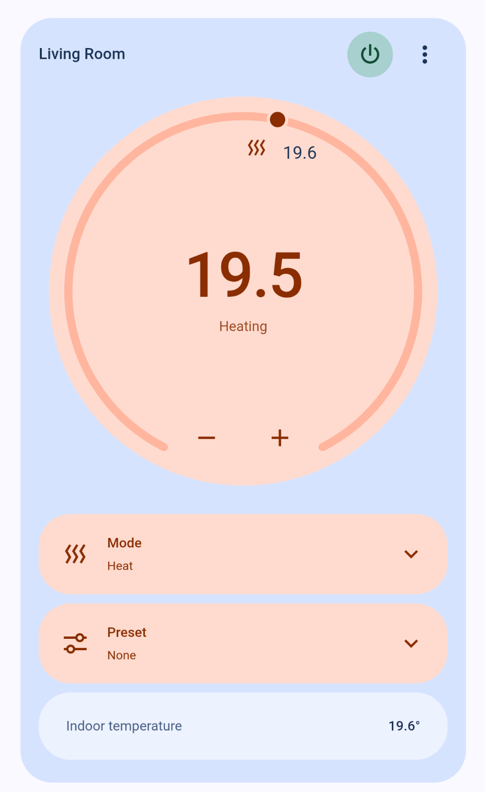
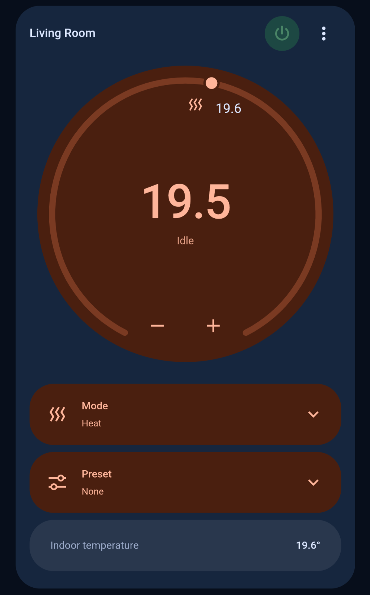

# Material Thermostat Card

<p align="center">
  
  
</p>

A Material-style dial thermostat card for Home Assistant, inspired by the Google Home app.

[](https://hacs.xyz)
[](https://github.com/Valiceemo/material-thermostat-card/releases)
[](LICENSE)


## Features

- **Dial control:** drag the ring or use the − / + buttons
- **At a glance:** target and current temperature markers, plus heating / cooling status
- **Modes:** heat, cool, auto, dry and fan selector, with preset, fan and swing selectors when the entity supports them
- **Dual setpoint:** low / high handles for `heat_cool` entities
- **Info tile:** indoor, outdoor and humidity, optionally from separate sensors
- **Themes:** colours follow the HVAC mode and adapt to light and dark themes
- **Easy setup:** visual editor, no build step, no dependencies

## Installation

### HACS (custom repository)

[](https://my.home-assistant.io/redirect/hacs_repository/?owner=Valiceemo&repository=material-thermostat-card&category=plugin)

Or add it by hand:

1. HACS → ⋮ → **Custom repositories**
2. Add `https://github.com/Valiceemo/material-thermostat-card` with category **Dashboard**
3. Find **Material Thermostat Card** in HACS, click **Download**, then reload the browser

### Manual

1. Copy `material-thermostat-card.js` to `/config/www/`
2. Add a dashboard resource: `/local/material-thermostat-card.js` (type: **JavaScript module**)

## Usage

Minimal:

```yaml
type: custom:material-thermostat-card
entity: climate.living_room
```

With all options:

```yaml
type: custom:material-thermostat-card
entity: climate.living_room
name: Living Room
outdoor_entity: sensor.outdoor_temperature
indoor_temperature_entity: sensor.living_room_temperature
humidity_entity: sensor.living_room_humidity
```

## Options

| Option | Type | Default | Description |
| --- | --- | --- | --- |
| `entity` | string | required | A `climate` entity |
| `name` | string | friendly name | Card title |
| `outdoor_entity` | string | none | A temperature `sensor` or a `weather` entity |
| `indoor_temperature_entity` | string | none | Separate sensor for indoor temperature (falls back to the thermostat's own reading) |
| `humidity_entity` | string | none | Separate sensor for humidity |
| `step` | number | entity step | Override the temperature step |
| `hide_action` | boolean | `false` | Hide the heating / cooling / idle status under the number |
| `hide_humidity` | boolean | `false` | Hide humidity in the info tile |
| `hide_presets` | boolean | `false` | Hide the preset, fan and swing selectors |

## Notes

- Modes, status and preset names use Home Assistant's own translations. The info-tile labels are currently English only.
- The card only shows what your entity supports. For example, humidity needs either a `humidity_entity` or a `current_humidity` attribute.

## Issues and feedback

Found a bug or want a feature? Please [open an issue](https://github.com/Valiceemo/material-thermostat-card/issues).

## License

MIT
